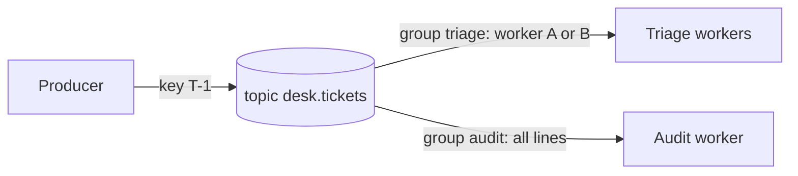

# Deep lesson 1: events, topics, consumers, and why Kafka

Features covered: F-002 (messages, Bus, MemoryBus). Passing. Kafka itself is F-010; see the last section.

## Problem

A ticket must go from the customer to a triage agent, then to a resolver. If triage calls the resolver directly and
the resolver is down, the ticket is lost. If two workers read the same list, they may do the same ticket twice or
handle one ticket's steps out of order.

## Concept (eli5)

A **topic** is a roll of paper you can only write at the end of. A **record** on it has a **key** (which ticket)
and a **value** (the message). A **consumer** reads the next unread line. A **consumer group** is a team: the team
shares the roll, each line is read by one member. A second team has its own bookmark and reads every line.



## Design decision and alternatives

- A small interface, `Bus` and `Consumer` (`src/agent_desk/bus.py:19-45`): `publish`, `consume`, `poll`, `commit`,
  `close`. Two implementations: `MemoryBus` now, `KafkaBus` later (D-004).
- `MemoryBus` copies only the rules that matter: per-key order, groups, commit after handle, redelivery (D-004).
- Alternative: call functions directly (no durability); a plain Python `queue.Queue` (no groups, no redelivery, no
  keys); Kafka in every test (slow, needs a broker, D-013).
- Why Kafka in the end: it is a durable, replayable, partitioned log; many companies run it. UNVERIFIED for this
  project until F-010. Kafka on Windows is for development only (D-017).

## Code walkthrough

1. A record holds topic, key, value bytes, headers and offset: `bus.py:9-16`. Bytes, not objects: this is what goes
   on the wire in Kafka too.
2. `publish` appends a copy under a lock and sets the offset to the log length: `bus.py:56-60`.
3. `consume` makes a consumer for a list of topics and a group name: `bus.py:62-64`.
4. `poll` walks the log in order (`bus.py:87`). It skips committed offsets (`:88`). If a record is claimed by
   another consumer in the same group, its key is put in `blocked_keys` (`:91-93`), so a later record with the same
   key is not handed out. That is the per-key order rule. A record with a different key may pass.
5. The first free record is claimed and returned (`bus.py:96-98`). The consumer keeps it as `_pending`, so calling
   `poll` again returns the same record until commit (`bus.py:82`).
6. `commit` marks the offset committed for the group and removes the claim: `bus.py:101-108`. `close` drops the
   claim without committing, so another consumer can take the record: `bus.py:110-117`.
7. Messages are checked before use. `parse_message` validates the JSON against a discriminated union on `type`
   (`messages.py:105-119`). A bad field raises `BadMessage` that names the field.

## Run it

```powershell
cd D:\Projects\agent-desk
.venv\Scripts\python.exe -m pytest -q tests/test_memory_bus.py tests/test_messages.py -p no:cacheprovider
```

Expected (MEASURED): `3 passed` for the bus file and `15 passed` for the messages file, so `18 passed` together.

## Break it

Open `src/agent_desk/bus.py` and delete lines 91-93 (the `blocked_keys.add` branch, keep the `continue`).
Predicted (not run): `tests/test_memory_bus.py::test_same_key_order` fails, because consumer two can now take the
second record of `T-1` while consumer one still holds the first. Explain why per-key order needs that rule. Undo the
change after (do not commit it).

## Quiz

1. Why is the key `ticket_id`? *All events of one ticket stay in order; different tickets can run in parallel.*
2. Two consumers share group `triage`, a third is in group `audit`. Who sees record 0? *One of the two triage
   workers, and the audit worker.*
3. Why does `poll` keep returning the same record until commit? *So the consumer cannot skip work by polling
   again; the record is redelivered if the consumer dies before commit.*

## Kafka: offsets and redelivery (F-010)

`KafkaBus` (`src/agent_desk/kafka_bus.py:50`) has the same methods as `MemoryBus`, so the runner does not change.

1. A consumer joins a group with `enable.auto.commit` off (`kafka_bus.py:79-81`). Kafka never moves the bookmark
   by itself.
2. `poll` reads one record and keeps it as pending (`kafka_bus.py:98-116`). Polling again returns the same
   record. Nothing is read ahead, so a later commit cannot skip a failed record.
3. The handler runs. If it raises, nobody calls `commit`.
4. `commit` stores `offset + 1` and waits for the broker (`kafka_bus.py:118-125`). `offset + 1` is the next
   record to read.
5. `close` does not commit (`kafka_bus.py:127-130`). The next consumer in the group starts at the old bookmark and
   gets the record again. That is at-least-once; exactly-once is not claimed.

Offline proof: `tests/test_kafka_bus_offline.py:58` logs "handled" before "commit" with a fake client.
Live proof (needs the broker): `tests/kafka/test_kafka_live.py:43` closes a consumer without commit, and a new
consumer in the same group gets the same offset.

Run it (MEASURED 2026-11-02, Kafka 4.3.2 on this PC):

```powershell
powershell -File scripts/kafka-local.ps1 start
powershell -File scripts/kafka-local.ps1 topics
$env:AGENT_DESK_KAFKA_BOOTSTRAP = "127.0.0.1:9092"; uv run pytest -m kafka -n 0 -v   # 3 passed
powershell -File scripts/kafka-local.ps1 stop
```

Break it: in `commit`, change `record.offset + 1` to `record.offset`. Predicted (not run): the live tests still
pass, but after a restart the last committed record comes back once more. Is that still at-least-once? Why is it a
bug anyway?
