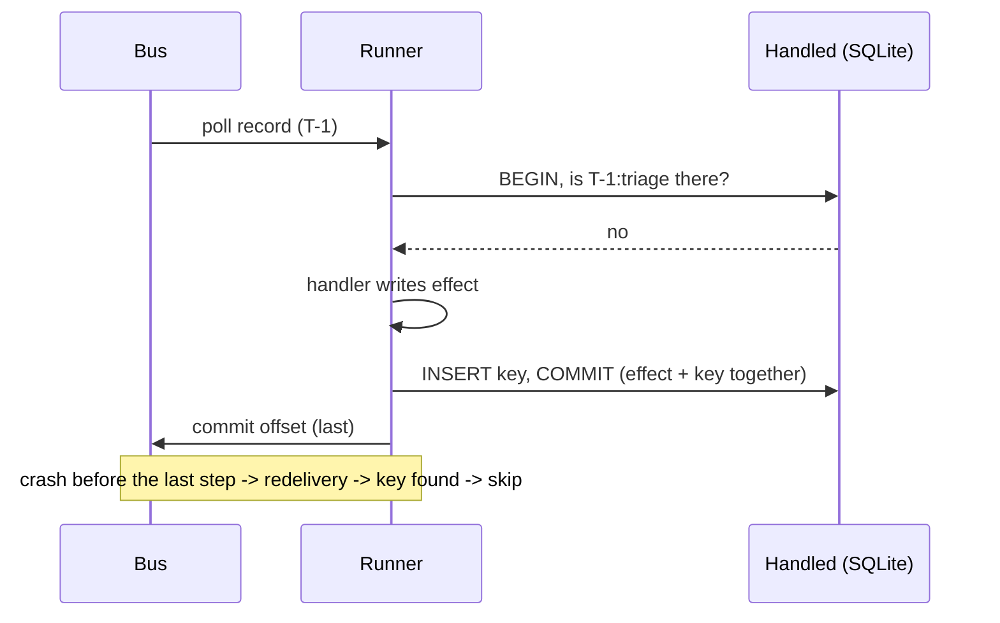

# Deep lesson 2: at-least-once delivery and idempotent consumers

Features covered: F-003 (first half: handled store and commit order), F-004 (idempotent refund tool). Passing.

## Problem

The consumer finishes the work and then crashes before it can say "done". The bus delivers the record again. A
refund must not be paid twice. Also: the consumer saves "I did T-1" and then crashes before it does the work. Now
the work is lost.

## Concept (eli5)

The bus promises: "I will keep giving you this note until you tell me you are done." So you may get the note twice.
The fix is on your side: keep a notebook of finished jobs. Look in the notebook first. Write in the notebook **in
the same breath** as you do the job, so you cannot do one without the other.



## Design decision and alternatives

- **Commit last** (`runner.py:68`). At-least-once. The alternative, commit first, is at-most-once: a crash loses
  the ticket.
- **Key in the same transaction as the effect** (`handled.py:21-36`). Alternatives: an in-memory set (lost on
  restart, `tests/test_handled.py:10`); key saved first (loses work on crash); a distributed lock (more moving
  parts).
- **No exactly-once claim** (D-003). The effect and the broker cannot share one transaction here.
- **Three layers**, because the handler may call things outside its own database:
  1. handled store `Handled.run`,
  2. a fixed UUID5 message id for the result (`resolver.py:161`),
  3. an idempotent tool: unique `idempotency_key` in the refunds table (`shop_db.py:26`, logic `:86-94`).

## Code walkthrough

1. The key is `<ticket_id>:<stage>` (`runner.py:46`). Each consumer also has a name; the table primary key is
   `(consumer, idempotency_key)` (`handled.py:15-19`), so triage and resolver never collide.
2. `Handled.run` opens `BEGIN IMMEDIATE` (`handled.py:23`) to take the write lock at once.
3. It looks for the key (`:25-29`). Found: roll back and return `False` (a duplicate, the handler is not called).
4. Not found: call the handler with the same connection (`:30`). Anything the handler writes through that connection
   is part of the transaction.
5. Insert the key and commit (`:31-33`). Any exception: roll back both effect and key (`:34-36`). Test:
   `tests/test_handled.py:25` and `:49` (a failed key write rolls back the effect).
6. In `Runner.process`, a duplicate returns normally, so the record is committed with no work done
   (`runner.py:58`, `:68`).
7. The refund tool (`shop_db.py:74`): open a write transaction (`:86`), look up the key (`:87-90`). A match with
   the same order and cents returns the same refund (`:91-94`); a match with different data raises (`:92-93`).
   Else it checks the remaining order total (`:102`) and inserts (`:104`).
8. Honest gap: `Triage.handle` publishes to `desk.work` inside the handler, before the key insert
   (`triage.py:61`, `handled.py:31`). A crash between them means a second publish after redelivery. The resolver's
   own key `T-1:resolve` absorbs the duplicate.

## Run it

```powershell
.venv\Scripts\python.exe -m pytest -q tests/test_handled.py tests/test_shop_db.py -p no:cacheprovider
.venv\Scripts\python.exe -m pytest -q "tests/test_runner.py::test_duplicate_and_commit_failure" -p no:cacheprovider
```

Expected (MEASURED): `3 passed` + `8 passed` for the first command (11 total), and `1 passed` for the second.

## Break it

In `src/agent_desk/runner.py`, move `subscription.commit(record)` so it runs before the retry loop (at the top of
the `process` method after parsing). Predicted (not run): the commit-failure test no longer shows a redelivery, and
a handler failure now loses the record from the input topic. Write down which guarantee changed (at-least-once to
at-most-once). Undo after.

## Quiz

1. Why `BEGIN IMMEDIATE`? *Take the write lock before the check, so two workers cannot both see "not handled" and
   both run.*
2. Where can a duplicate publish still happen? *Between publishing the next event and saving the key; the next stage
   dedups by its own key.*
3. Why is the refund tool idempotent too, if the consumer already is? *A tool can be called from other places and
   from a graph that re-runs a node after a crash; defense in depth at the money step.*
