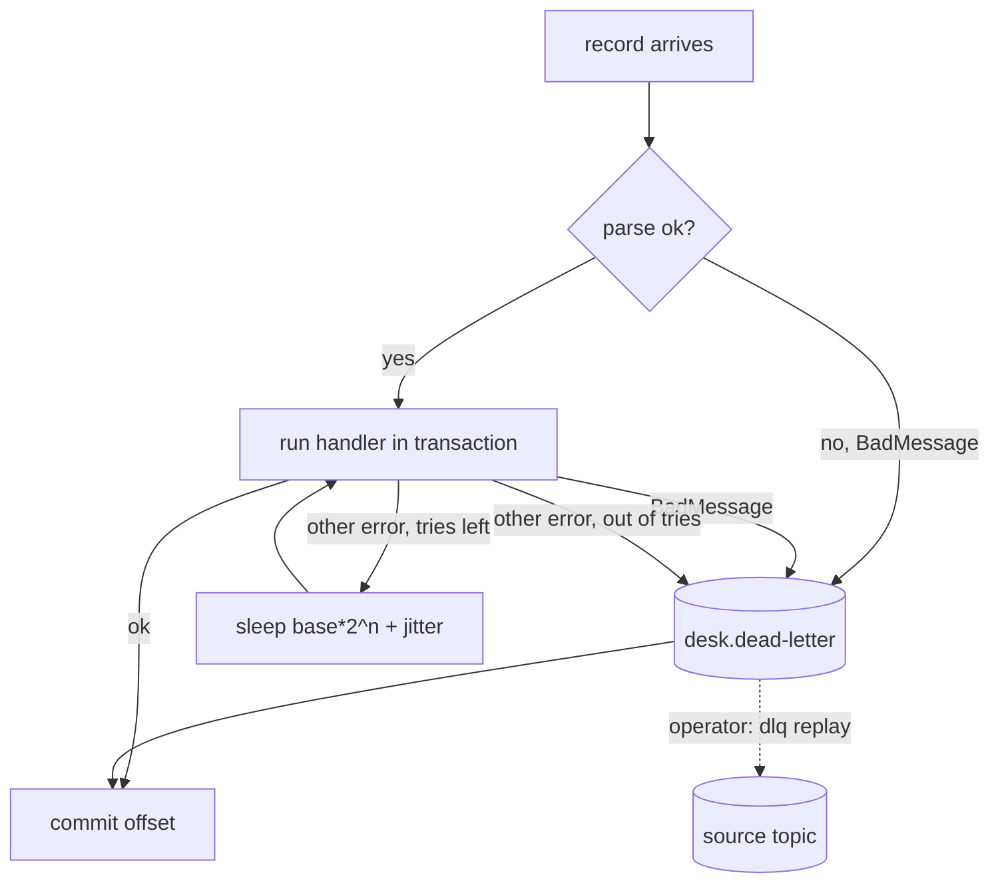

# Deep lesson 3: retries with backoff, dead letters, and replay

Features covered: F-003 (runner). Passing.

## Problem

Two kinds of failure look the same from far away. (a) The model server is busy right now: try again in a moment.
(b) The message is broken JSON: it will never work. If you retry (b) forever, or stop the whole line on (a), the
desk is stuck.

## Concept (eli5)

- **Retry with backoff**: the door is locked, so wait 1 minute, then 2, then 4. Add a small random wait so the whole
  crowd does not come back at the same second (**jitter**).
- **Dead-letter queue (DLQ)**: a "problem shelf". After the last try, put the letter on the shelf with a sticky note
  that says why, and move on.
- **Replay**: when the cause is fixed, a person takes the letter off the shelf and puts it back in the line.



## Design decision and alternatives

- Own loop of about 15 lines, no retry library (D-010). A library hides the lesson; tests need an injected clock.
- Dead letter keeps the **original bytes**; the facts go in headers: `dlq-reason`, `dlq-source-topic`,
  `dlq-attempts` (D-011, `runner.py:78-85`).
- Poison (a `BadMessage`) is never retried (`runner.py:60`).
- Commit after the dead letter, so the line moves on (`runner.py:68`). If the DLQ publish fails, nothing is
  committed and the record comes back.
- Alternatives: infinite retry (blocks the line), drop on failure (silent loss), retry in a separate "retry topic"
  with delays (more topics; a production option, UNVERIFIED here).

## Code walkthrough

1. Constructor checks `max_attempts >= 1` and a finite, non-negative base (`runner.py:30-31`). `sleep` and `jitter`
   are parameters (`runner.py:27-28`): tests pass fakes.
2. `process` first parses and checks the idempotency header (`runner.py:44-52`). Bad input is dead-lettered with
   attempts `0` and committed at once.
3. The loop `for attempt in range(1, max_attempts + 1)` (`runner.py:54`) writes the `attempt` header and logs it
   (`:55-56`).
4. The handler runs inside `Handled.run`, so a failed attempt rolls back its writes (`runner.py:58`,
   `handled.py:34-36`).
5. On an exception: a `BadMessage` or the last attempt goes to `_dead_letter` and the loop ends (`:60-62`).
   Else sleep `base * 2 ** (attempt - 1)` plus jitter in `[0, 0.1 * base]` (`:64-65`). With base 1.0 the waits are
   about 1.0 s and 2.0 s.
6. `else: break` (`:66-67`) leaves the loop on success. `subscription.commit(record)` runs once, after the loop
   (`:68`).
7. `list_dead_letters` reads with a throw-away group name `dlq-view-<uuid>` and commits what it reads, so it never
   affects real consumers (`runner.py:88-98`).
8. `replay` reads `dlq-source-topic`, refuses an empty value or the DLQ itself, strips every `dlq-*` header and
   the `attempt` header, then publishes the original bytes to the source (`runner.py:101-110`). The CLI wires
   `agent-desk dlq list` and `agent-desk dlq replay <offset>` (`cli.py:27-40`).

## Run it

```powershell
.venv\Scripts\python.exe -m pytest -q tests/test_runner.py -p no:cacheprovider -v
```

Expected (MEASURED): `7 passed`. The test names include `test_retries_headers_backoff_and_logs`,
`test_dead_letter_then_next_and_replay[poison|schema|transient]` and `test_dlq_publish_failure_does_not_commit`.

What the tests prove:
- `tests/test_runner.py:51`: two failures then success; handler called 3 times; delays exactly `[2.2, 4.2]` with
  base 2 and jitter forced to its upper bound 0.2.
- `tests/test_runner.py:85`: poison gives 0 handler calls and `dlq-attempts=0`; schema error gives 1 call;
  transient gives 3 calls and 2 sleeps; the next ticket T-2 is still handled; replay restores the original headers.
- `tests/test_runner.py:127`: a failed DLQ publish does not commit the input.

## Break it

In `src/agent_desk/runner.py:60`, change the condition to `if attempt == self.max_attempts:` (remove the
`BadMessage` check). Predicted (not run): the `poison` and `schema` cases of the DLQ test fail because the runner now
retries a message that can never succeed (calls and delays no longer match). Explain why retrying bad input is waste.
Undo after.

## Quiz

1. Why does the delay double? *Gives a failing service more time to recover; short fixed delays keep hitting it.*
2. Why jitter? *Many consumers failing together would retry together; a random extra spreads them.*
3. Replay puts the same bytes back. What stops a double effect? *Idempotent consumers: the handled store skips a key
   that already finished (lesson 2). If the first run failed, the key was never saved, so replay does the work.*
