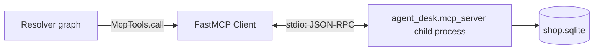

# Deep lesson 4: MCP servers with FastMCP

Features covered: F-004 (seeded shop DB and FastMCP server). Passing. The graph that calls it is lesson 6.

## Problem

The resolver needs shop facts (orders, shipments, policy) and one action (refund). If the graph code opens the
database itself, every agent must copy the same rules, and a model bug can reach the database directly.

## Concept (eli5)

MCP (Model Context Protocol) is a plug standard for tools. The **server** shows a menu: "lookup_order, shipment_status,
refund_policy, issue_refund", each with a description and typed inputs. A **client** reads the menu and calls a tool
by name. When a tool fails it returns an **error result** (`isError`) with words the model can read, instead of
crashing the server.



## Design decision and alternatives

- **FastMCP, stdio** (D-007). The client starts the server as a child process; no port to open or protect.
- Alternatives: HTTP transport (needs a port and auth), plain Python functions in the graph (no process boundary, no
  standard, not reusable by other agents).
- The server owns the rules: cents math, remaining balance, unique key. The graph owns the workflow.
- Errors are data: `ToolError` becomes an MCP error result that names what was wrong and what is valid.

## Code walkthrough

1. `create_server(path)` makes `FastMCP("agent-desk-shop")` and one `ShopDB` (`mcp_server.py:13-16`). Tests build it
   in process; production runs it with `python -m agent_desk.mcp_server` (`mcp_server.py:50-56`).
2. `call(name, *args)` is the single error gate: `ValueError` from the shop becomes `ToolError(str(error))`;
   a `sqlite3.Error` becomes "Shop database is unavailable; run agent-desk seed first" (`mcp_server.py:18-25`).
   Nothing else leaves the server as a Python traceback.
3. Four tools are registered with `@server.tool` (`mcp_server.py:27-45`). The docstring is the tool description the
   model sees, so it names valid ids ("such as O-1 or O-2"). Type hints become the input schema.
4. `issue_refund` is the only write. It takes an `idempotency_key` argument. The graph sends `<ticket>:refund`
   (`resolver.py:151`). A repeat returns the same refund (`shop_db.py:91-94`).
5. The client wraps one MCP session per call (`mcp_client.py:26-39`). `raise_on_error=False` lets the code read
   `result.is_error` and raise its own `McpError` with the server's text (`mcp_client.py:31-34`).
   `# shortcut:` at `:38` says a session per call is fine for a demo but slow for real traffic.
6. `McpTools(server)` with a `FastMCP` object uses the in-process transport; without it, a `StdioTransport` starts
   the real child process with `AGENT_DESK_DB_PATH` set (`mcp_client.py:19-24`).

## Run it

```powershell
.venv\Scripts\python.exe -m pytest -q tests/test_shop_db.py tests/test_mcp_server.py -p no:cacheprovider
.venv\Scripts\python.exe -m pytest -q "tests/test_resolver.py::test_native_stdio_shop" -p no:cacheprovider
```

Expected (MEASURED): `8 passed` + `2 passed` (10 total), then `1 passed` for the real child process test.

`tests/test_mcp_server.py:12` lists the four tool names and checks seeded values (order `O-1` total 30, shipment
`in_transit`, refund policy `max_days` 30). `tests/test_mcp_server.py:40` checks that errors return as results.

## Break it

In `src/agent_desk/mcp_server.py:23`, change `raise ToolError(str(error)) from None` to `raise`. Predicted (not run):
`tests/test_mcp_server.py::test_errors_are_mcp_results` fails or the client sees a generic failure instead of the
named-id message, because the exception no longer becomes a clean error result. Explain why a model needs the
message text to repair its next call. Undo after.

## Quiz

1. Why return errors as results and not crash? *The calling agent can read the message and try again; a crash ends
   the session.*
2. Why does the refund tool take its own key if the consumer is already idempotent? *A graph node can re-run after a
   crash; the tool is the last guard before money moves.*
3. Why stdio instead of HTTP here? *Local only; the client owns the child process; no port, no auth to manage.*
