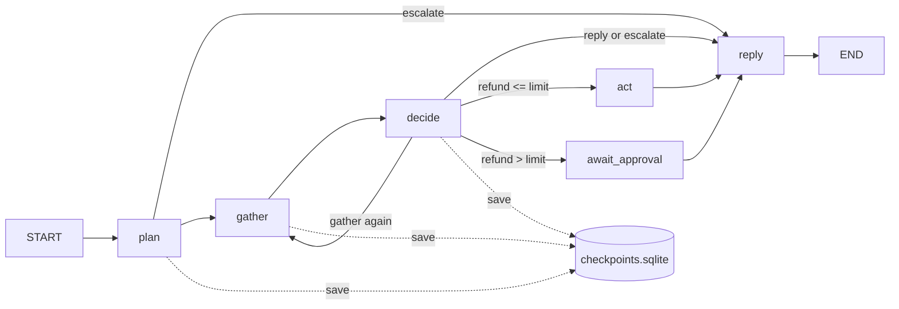

# Deep lesson 6: LangGraph state, nodes, edges, checkpoints, resume

Features covered: F-006 (resolver graph with SQLite checkpointer and MCP tools). Passing.
The human approval flow (F-007) is NOT built: `await_approval` is a stub.

## Problem

Resolving a ticket takes several steps and some are paid (model calls) or risky (refund). If the process dies after
step 3 of 6, a naive restart repeats the paid calls and may repeat the refund. We also need a hard cap so a
confused model cannot loop forever.

## Concept (eli5)

A board game. **State** is your bag. Each **node** is a square that changes the bag. **Edges** are arrows; a
**conditional edge** is "look at the bag, then pick an arrow". A **checkpointer** is save-game: after each square it
writes the bag to disk under a name (the **thread id**). **Resume** means load the save and play the next square.



## Design decision and alternatives

- **LangGraph with a SQLite checkpointer** (D-005): durable state and `interrupt` without another service.
  Alternatives: hand-written state machine (done in Agent Lab), Postgres saver (extra service), no saver (loses work).
- **Thread id = ticket id** (`resolver.py:201`): one save slot per ticket.
- **LLM proposes, code checks**: plan and decide use the model; `gather`, `route`, `act`, `reply` are plain code.
  `route` applies the money limit, not the model (`resolver.py:135-136`).
- **Bounded**: `max_model_calls` default 8; at the cap the graph escalates with a clear message (`resolver.py:64-66`).
- **Result built inside the graph** so a restart publishes the same message (`resolver.py:157-166`, UUID5 id).

## Code walkthrough

1. State is a `TypedDict` (`resolver.py:22-38`): ticket, messages, order, shipment, policy, proposed refund, steps,
   model call count, action, result.
2. `ask` is the one model gate (`resolver.py:62-76`): check the budget, call `model.chat`, validate JSON against a
   Pydantic schema (`Plan` or `Decision`, `:41-52`), reject tool calls, return an update with `model_calls + 1`.
3. `plan` (`:78`) picks `status`, `refund` or `escalate`. `gather` (`:89`) calls `lookup_order`, maybe
   `shipment_status`, and `refund_policy` via MCP, and rejects an order that belongs to another customer (`:95-96`).
4. `decide` (`:103`) asks the model and then **checks**: a refund needs a refund ticket and a known order (`:115`),
   and an amount no larger than the order total (`:117`).
5. `route` (`:128`) is the conditional edge. Refund amount `<= min(refund_limit, policy.auto_limit)` goes to `act`,
   else `await_approval` (`:135-136`).
6. `act` (`:147`) calls `issue_refund` with key `<ticket>:refund`. `reply` (`:157`) builds the final
   `ticket.resolved` message with a fixed UUID5 id and stores it in state as `result`.
7. Wiring: `StateGraph(ResolverState)`, six `add_node` calls (`:168-171`), edges and conditional edges
   (`:172-178`), then `compile(checkpointer=..., interrupt_after=...)` (`:179`).
8. `Resolver.__init__` opens the checkpoint file and passes `SqliteSaver(connection)` (`:187-195`).
9. **Resume** is in `Resolver.run` (`:197-212`): `get_state(config)` (`:203`). If values exist and `next` is empty,
   the run is finished: return saved state (`:204-205`). If values exist and `next` is not empty, pass `None` as
   input so LangGraph continues from the saved next node (`:206`). Else start with fresh state (`:206-211`).
10. `Resolver.handle` publishes `desk.results` only when the state has a `result` (`:214-221`). A paused large
    refund returns without a result, so the runner commits and other tickets keep flowing.
11. The stub: `await_approval` calls `interrupt(...)` (`:141`). Its return statement (`:144`) is what runs after a
    resume today ("Human approval is required", status escalated). The real decision handling is F-007.

## Run it

```powershell
.venv\Scripts\python.exe -m pytest -q tests/test_resolver.py -p no:cacheprovider -v
```

Expected (MEASURED): `10 passed` in about 19 s (one test starts a real stdio child process).

Key tests:
- `tests/test_resolver.py:38` status ticket reaches `reply` with no approval.
- `:56` a refund at or below the limit goes plan, gather, decide, act, reply.
- `:72` the default step limit is 8 model calls.
- `:87` stop after `gather`, close, open a second `Resolver` on the same file: MCP calls stay
  `["lookup_order","shipment_status","refund_policy"]`, steps end `["plan","gather","decide","reply"]`, and
  `model_calls == 2`.
- `:119` a failed commit plus a re-sent ticket gives one result and one refund row.
- `:166` a 75 refund (over the 50 limit) pauses at `await_approval` and writes no refund row.

## Break it

In `src/agent_desk/resolver.py:206` change `initial = None if saved.values else {...}` so it always builds the fresh
dict. Predicted (not run): `test_restart_after_gather` fails because the second process starts the graph again
(MCP read list longer, or a model script mismatch) instead of resuming. Explain how `None` tells LangGraph "continue
from the saved checkpoint". Undo after.

## Quiz

1. What is the thread id for and why the ticket id? *It names the save slot; one ticket, one slot, so a redelivered
   message finds its own saved state.*
2. A node crashes in the middle of its work. Can it run twice? *Yes; the checkpoint is written after a node
   finishes, so design nodes and tools to be safe when repeated (the refund key does this).*
3. Why must the model not decide whether a refund needs approval? *Money rules must be deterministic and testable;
   the model only proposes an amount, `route` compares it to the limit.*
